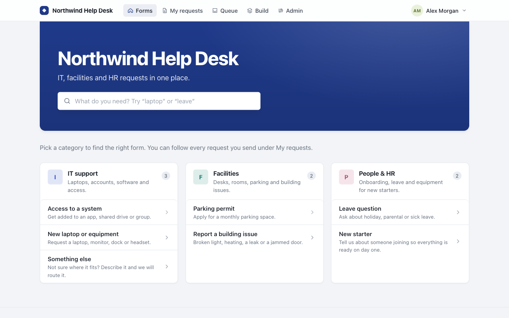
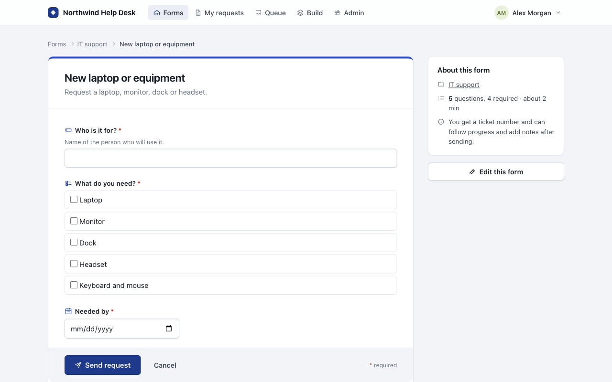
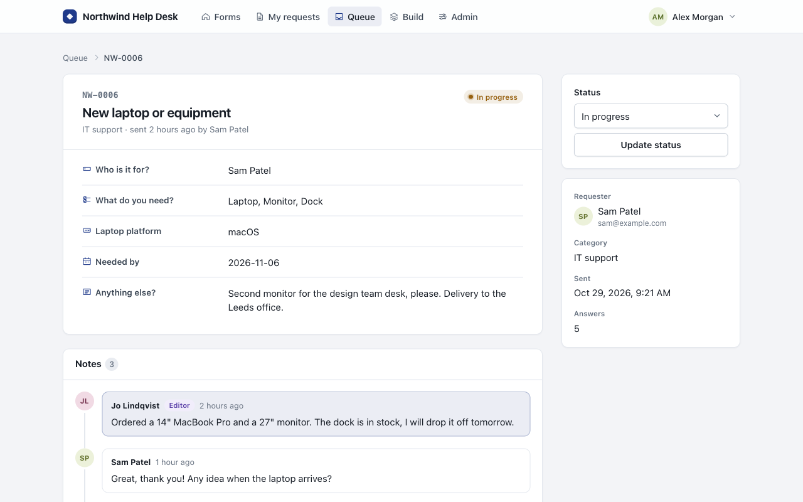
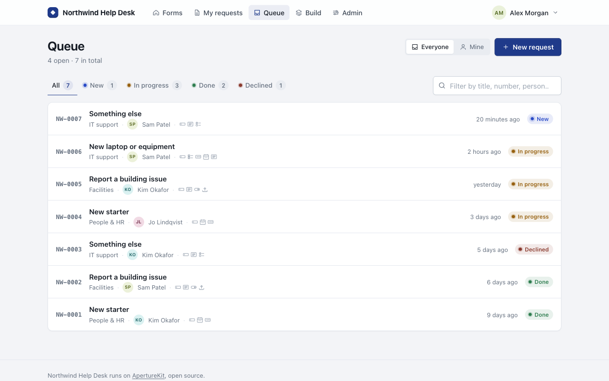
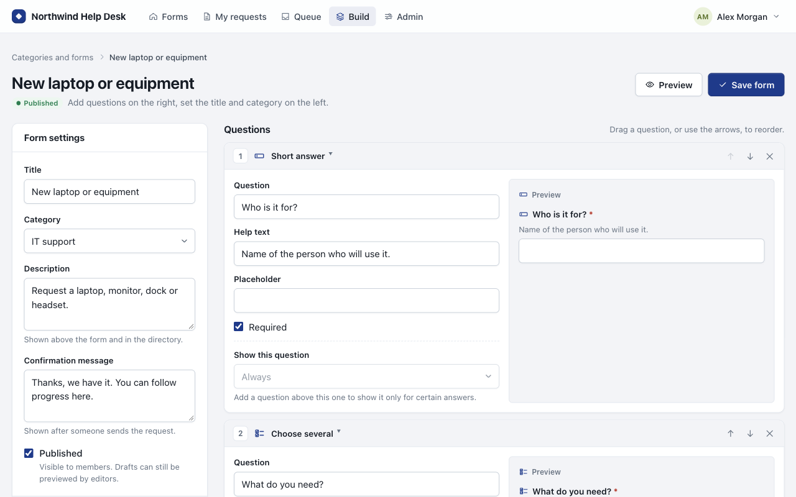
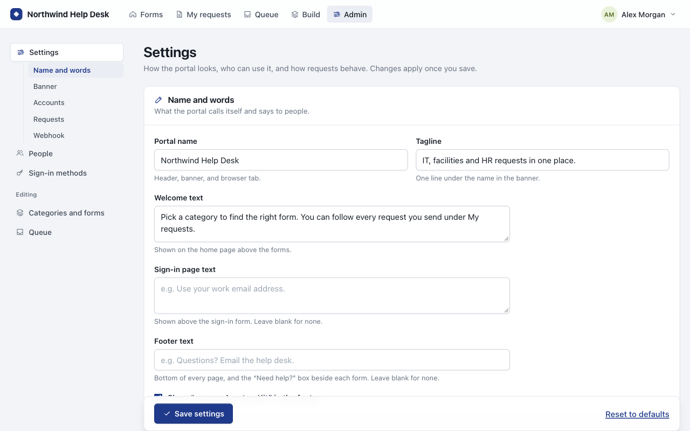
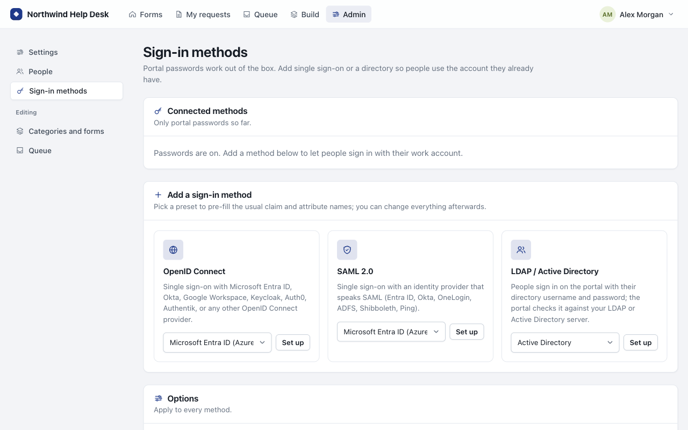

<div align="center">


# ApertureKit

**A self-hosted request portal for IT, facilities, HR, or any team that takes requests.**

Editors build categories and request forms. Members pick a form, send a
request, and follow it to completion.

[](LICENSE)
[](https://nodejs.org)
[](#quick-start-docker)
[](#how-it-works)

[Quick start](#quick-start-docker) ·
[Deploy to Azure](#deploy-to-an-azure-vm) ·
[Features](#features) ·
[Configuration](#configuration) ·
[Changelog](CHANGELOG.md)

<br>



</div>

---

## Contents

- [Why ApertureKit](#why-aperturekit)
- [Screenshots](#screenshots)
- [Installation](#installation)
  - [Quick start (Docker)](#quick-start-docker)
  - [HTTPS without a separate proxy](#https-without-a-separate-proxy)
  - [Deploy to an Azure VM](#deploy-to-an-azure-vm)
  - [Docker without Compose](#docker-without-compose)
  - [Running without Docker](#running-without-docker)
- [Features](#features)
- [Single sign-on and directories](#single-sign-on-and-directories)
- [Webhooks (n8n and friends)](#webhooks-n8n-and-friends)
- [Configuration](#configuration)
- [Running in production](#running-in-production)
- [Security](#security)
- [Development](#development)
- [License](#license)

## Why ApertureKit

- **Small and self-contained.** One Node.js process and one SQLite file. No
  build step, no external services, six npm dependencies.
- **Set up from the browser.** Branding, accounts, sign-in methods, session
  limits and webhooks are all admin settings. Nothing needs a restart.
- **Works with the accounts you already have.** Portal passwords out of the
  box, plus OpenID Connect, SAML 2.0, and LDAP / Active Directory.
- **Easy to run.** `docker compose up` locally, built-in HTTPS on a public
  server, or one command to a new Azure VM.

## Screenshots

<table>
  <tr>
    <td width="50%">
      
      <p align="center"><b>Request forms</b><br><sub>Every question type has its own icon, shown the same way everywhere.</sub></p>
    </td>
    <td width="50%">
      
      <p align="center"><b>Request tracking</b><br><sub>Ticket numbers, statuses, and a thread of notes for everyone involved.</sub></p>
    </td>
  </tr>
  <tr>
    <td width="50%">
      
      <p align="center"><b>Queue</b><br><sub>Filter by status, search by title, number, or person.</sub></p>
    </td>
    <td width="50%">
      
      <p align="center"><b>Form builder</b><br><sub>Drag to reorder, preview as you go, add show-when rules.</sub></p>
    </td>
  </tr>
  <tr>
    <td width="50%">
      
      <p align="center"><b>Settings</b><br><sub>Name, banner, accounts, requests, and webhook, all without a restart.</sub></p>
    </td>
    <td width="50%">
      
      <p align="center"><b>Sign-in methods</b><br><sub>Presets for Entra ID, Okta, Google, Keycloak, AD, and more.</sub></p>
    </td>
  </tr>
</table>

## Installation

| Method | Best for | You need |
|---|---|---|
| [Docker Compose](#quick-start-docker) | Most installs, local or on a server | Docker |
| [Built-in HTTPS](#https-without-a-separate-proxy) | A public server with a domain name | Docker, ports 80 and 443 |
| [Azure VM](#deploy-to-an-azure-vm) | A new cloud server in one command | Azure CLI and a subscription |
| [Bare Node.js](#running-without-docker) | Hosts without Docker | Node.js 24.7+ |

### Quick start (Docker)

```sh
git clone https://github.com/Ruben-C/ApertureKit.git
cd ApertureKit
docker compose up -d --build
```

Open <http://localhost:3000>. The first visit asks you to create the
administrator account, adds a starter category and form, and takes you to
Settings to name the portal and set up the banner.

Everything persistent (SQLite database, uploads, session secret) is kept in
the `aperturekit_data` volume. The container runs as an unprivileged user,
reports its health to Docker through `/healthz`, and shuts down cleanly on
`docker stop`.

Day-to-day commands:

```sh
docker compose logs -f                      # follow the log
git pull && docker compose up -d --build    # upgrade
docker compose down                         # stop (data stays in the volume)
```

To change settings, copy `.env.example` to `.env` next to
`docker-compose.yml`, edit it, and run `docker compose up -d` again. See
[Configuration](#configuration) for what each setting does.

### HTTPS without a separate proxy

On a server with a public address, Compose can run
[Caddy](https://caddyserver.com) next to the portal and get a Let's Encrypt
certificate for you.

1. Point a DNS name at the server.
2. Open inbound ports 80 and 443.
3. Put this in `.env`:

   ```sh
   COMPOSE_PROFILES=https
   DOMAIN=portal.example.com
   TRUST_PROXY=1
   BIND_ADDRESS=127.0.0.1
   ```

4. Run `docker compose up -d --build` as usual.

The portal is then served at `https://portal.example.com`, and certificates
renew on their own.

### Deploy to an Azure VM

With the [Azure CLI](https://learn.microsoft.com/cli/azure/install-azure-cli)
installed and signed in (`az login`), one command creates an Ubuntu 24.04 VM,
installs Docker on first boot, and starts the portal with HTTPS:

```sh
deploy/azure/deploy.sh myportal westeurope
```

After about five minutes it prints the portal's address, such as
`https://myportal.westeurope.cloudapp.azure.com`. That is a free Azure DNS
name with its own certificate, so you don't need a domain.

> [!IMPORTANT]
> Open the portal as soon as it is up and create the administrator account.
> Until someone does, the first visitor gets to.

Everything lives in the resource group `myportal-rg`, and
`az group delete -n myportal-rg` removes it all.

<details>
<summary><b>Options, manual setup, and upgrades</b></summary>

<br>

| Variable | Default | Meaning |
|---|---|---|
| `DOMAIN` | `<name>.<location>.cloudapp.azure.com` | Use your own domain instead; point its DNS at the IP the script prints |
| `VM_SIZE` | `Standard_B1s` | Azure VM size |
| `RESOURCE_GROUP` | `<name>-rg` | Resource group to create the VM in |
| `REPO` | this repository | Git URL to deploy from |
| `BRANCH` | `main` | Branch to deploy |

For example:

```sh
DOMAIN=help.example.com VM_SIZE=Standard_B2s deploy/azure/deploy.sh helpdesk uksouth
```

**Setting it up in the Azure portal instead:** create an Ubuntu 24.04 VM,
fill in the placeholders in `deploy/azure/cloud-init.yaml` and paste it as
*Custom data* (under *Advanced*), then allow inbound ports 80 and 443.

**Upgrading:** the checkout lives in `/opt/aperturekit` on the VM.

```sh
ssh azureuser@<ip> 'cd /opt/aperturekit && sudo git pull && sudo docker compose up -d --build'
```

</details>

### Docker without Compose

```sh
docker build -t aperturekit .
docker run -d --name aperturekit --restart unless-stopped --init \
  -p 3000:3000 -v aperturekit_data:/data -e TRUST_PROXY=1 aperturekit
```

To keep the data in a host directory instead of a named volume, mount it at
`/data` (`-v /srv/aperturekit:/data`, or `./data:/data` in the compose file)
and make sure uid 1000 can write to it:
`chown -R 1000:1000 /srv/aperturekit`.

### Running without Docker

Requires **Node.js 24.7 or newer**, for the built-in `node:sqlite` and Argon2.

```sh
npm install
npm start
```

For a long-running install, a minimal systemd unit:

```ini
[Unit]
Description=ApertureKit request portal
After=network.target

[Service]
WorkingDirectory=/opt/aperturekit
Environment=PORT=3000 TRUST_PROXY=1 PORTAL_DATA_DIR=/var/lib/aperturekit
ExecStart=/usr/bin/node src/server.js
Restart=on-failure

[Install]
WantedBy=multi-user.target
```

## Features

### Branding, with sensible defaults

Out of the box the portal is called "Request Portal" with a solid blue
banner. Administrators can change the name, tagline, welcome text, sign-in
page text, footer, banner color and text color, and upload a banner image.
One click resets everything to the defaults.

### Everything is a setting

The Settings page also controls:

- whether the portal is private (sign in to see anything)
- whether people can create their own accounts, and from which email domains
- the role new accounts start with
- how long people stay signed in: an inactivity limit and an overall limit,
  8 hours and a week by default
- the largest file that can be attached to a request
- who can add notes to requests: everyone involved, editors only, or nobody
- the ticket number prefix
- whether the footer credits ApertureKit
- a webhook address for sending events to n8n or similar

Nothing on that page needs a restart or an environment variable.

### Roles

| Role | Can |
|---|---|
| **member** | Browse forms, send requests, add notes to their own requests |
| **editor** | Everything above, plus build categories and forms and work the queue |
| **admin** | Everything above, plus settings, people, and sign-in methods |

### Categories and forms

Editors create categories (name, description, color) and forms inside them.
The form builder supports these question types:

| | | |
|---|---|---|
| Short answer | Long answer | Email |
| Number | Date | Dropdown |
| Choose one | Choose several | Yes / no |
| File upload | Section heading | |

You add a question by picking its tile from a palette. Its icon marks the
question in the builder, on the member's form, and next to the answer on
the request page, so a form reads the same everywhere. Each question can be
required and have help text. Forms are drafts until published, so you can
preview them first.

### Conditional questions

Any question can be shown only for certain answers to a question above it,
for example *"Show this question when **Need parking?** is **Yes**"*. A rule
can also check that a question *is not* a given answer, *is answered*, or
*is not answered*. Put a rule on a section heading and it hides the whole
section up to the next heading.

The member's form shows and hides questions as they answer, and the server
applies the same rules when the request is sent. A hidden question is never
required, never stored, and never listed on the request.

### Requests

- Each submission gets a ticket number and a status: **New**,
  **In progress**, **Done**, or **Declined**.
- Members see their own requests. Editors see everyone's in a filterable,
  searchable queue.
- Anyone involved can add notes, unless an administrator limits notes to
  editors or turns them off.
- Each request stores a snapshot of its form, so editing a form later never
  breaks old requests.

### Accounts

Self-registration can be turned off, in which case administrators add
people from the People page. It can also be limited to certain email
domains, and new accounts can start as members or editors. A private portal
hides everything behind sign-in.

## Single sign-on and directories

Under **Admin → Sign-in methods**, an administrator can connect any number
of identity providers without a restart or any environment variables:

| Method | Works with |
|---|---|
| **OpenID Connect** | Microsoft Entra ID, Okta, Google Workspace, Keycloak, Auth0, Authentik, anything with a discovery document |
| **SAML 2.0** | Entra ID, Okta, OneLogin, AD FS, Shibboleth, PingFederate, … |
| **LDAP / Active Directory** | People use their directory username and password on the portal's own sign-in form |

Each method comes with presets that fill in the right claim and attribute
names, and shows the redirect URI, entity ID, ACS URL, or metadata URL to
paste into the identity provider. For every method you choose:

- whether accounts are created on first sign-in, and which role they start with
- optionally, which group makes someone an editor or an administrator. Roles
  are then kept in step on every sign-in, though the last administrator is
  never demoted.

Existing password accounts are linked by email the first time they sign in
through a provider, so moving an established portal over is painless. To
keep this safe, an account is only linked when the provider vouches for the
address: OpenID Connect providers must send `email_verified` (Entra ID:
add the optional `email` and `xms_edov` claims), while SAML and LDAP
addresses come from your own directory and are trusted.

Once single sign-on works you can turn off password sign-in. Administrators
can still use their portal password at `/login?password=1`, so a
misconfigured identity provider never locks you out. If the last provider is
removed or turned off, the portal turns passwords back on by itself.

<details>
<summary><b>Protocol details</b></summary>

<br>

- **OpenID Connect** uses the authorization-code flow with PKCE and verifies
  ID tokens against the provider's JWKS (RS/PS/ES/EdDSA). Public clients
  without a secret work too. Groups are read from a configurable claim,
  falling back to the userinfo endpoint.
- **SAML** expects signed assertions (or, if you turn that off, a signed
  response), rejects unsigned or tampered responses, and does not support
  encrypted assertions. Authentication requests are not signed. Both
  SP-initiated and IdP-initiated sign-in work.
- **LDAP** binds with a service account to find the person, then binds as
  them to check the password. Use `ldaps://` or StartTLS. Group membership
  comes from `memberOf` (or any attribute you name) and can be matched by
  CN or full DN. The provider page has a test button that tries the
  connection, the lookup, and optionally a password, without saving
  anything.
- Behind a reverse proxy, set `TRUST_PROXY=1` so callback URLs use the
  public scheme and host, or pin the portal address under
  **Sign-in methods → Options**.

</details>

## Webhooks (n8n and friends)

Under **Settings → Webhook**, an administrator can paste one address, and
the portal POSTs a JSON event to it whenever a request is sent, changes
status, or gets a note (each can be turned on or off). It is built to drop
straight into an [n8n](https://n8n.io) Webhook node, but any endpoint that
accepts JSON works.

1. In n8n, add a **Webhook** node, set its method to **POST**, and copy the
   production URL.
2. On the portal's Settings page, paste it as the webhook address. If you
   set a shared secret, set the Webhook node's authentication to
   **Header Auth** with the name `X-Webhook-Secret` and the same value.
3. Click **Save and send a test event**. A `webhook.test` event lands in
   n8n so you can build the rest of the workflow from real data.

<details>
<summary><b>Payload and headers</b></summary>

<br>

Every event carries `event`, `sent_at`, `portal` (name and address), and a
`request` object with `id`, `ticket`, `url`, `status`, `form`, `requester`,
`answers` (in form order, with labels), `answers_by_id`, and `attachments`.
Each attachment has a signed download `url` that works without an account
for seven days, so an n8n HTTP Request node can fetch the file. The
signature is tied to the session secret, so rotating that invalidates old
links.

| Event | Extra fields |
|---|---|
| `request.submitted` | none |
| `request.status_changed` | `previous_status`, `changed_by` |
| `comment.added` | `comment` |
| `webhook.test` | none |

Headers: `X-ApertureKit-Event` names the event. When a secret is set,
`X-Webhook-Secret` carries it and `X-Webhook-Signature` holds
`sha256=<HMAC-SHA256 of the body>`.

Delivery is fire-and-forget with a 10-second timeout. The request is always
saved first, and a failed POST is logged, never retried, and never shown to
the member.

</details>

## Configuration

Every setting is optional. With Docker Compose, put them in a `.env` file
next to `docker-compose.yml` (start from `.env.example`). Otherwise, set them
as environment variables.

| Variable | Default | Meaning |
|---|---|---|
| `PORT` | `3000` | Port to listen on (with Compose: the host port to publish) |
| `TRUST_PROXY` | `0` | Set to `1` behind a reverse proxy that terminates TLS (also marks cookies `Secure`) |
| `BIND_ADDRESS` | `0.0.0.0` | Host interface to publish the port on (Compose only); use `127.0.0.1` with `TRUST_PROXY=1` |
| `MAX_UPLOAD_MB` | `10` | Starting size limit for attached files; admins can change it under Settings |
| `SESSION_SECRET` | auto-generated | Signs session cookies; generated once and saved in the data directory if unset |
| `COMPOSE_PROFILES` | none | Set to `https` to start the built-in Caddy proxy (Compose only) |
| `DOMAIN` | none | Public name for the built-in HTTPS proxy (Compose only) |
| `HOST` | `0.0.0.0` | Interface to bind (bare Node only; the image binds all interfaces) |
| `PORTAL_DATA_DIR` | `./data` | Where the database, uploads, and session secret live (bare Node only; the image uses `/data`) |

## Running in production

**HTTPS.** Use the [built-in proxy](#https-without-a-separate-proxy), or put
the portal behind any reverse proxy that handles HTTPS (Caddy, nginx,
Traefik) and set `TRUST_PROXY=1`. Then make sure only the proxy can reach
port 3000 (`BIND_ADDRESS=127.0.0.1` with Compose), because the portal
believes the `X-Forwarded-For` header it is sent. A Caddyfile that fronts it
is two lines:

```
portal.example.com {
    reverse_proxy localhost:3000
}
```

**Health checks.** `GET /healthz` returns `200 ok` once the database is
reachable. The image already uses it for Docker's health check, and it works
well for uptime monitors.

**Backups.** Everything is in the data volume. To save a snapshot to a
tarball in the current directory:

```sh
docker run --rm -v aperturekit_data:/data -v "$PWD":/backup alpine \
  tar czf /backup/aperturekit-backup.tgz -C /data .
```

To restore, extract it into an empty volume the same way (`tar xzf`), then
run `docker compose up -d`.

## Security

- **Passwords** are hashed with Argon2id (64 MiB, 3 passes, 4 lanes). Hashes
  from versions before 0.6 (scrypt) are upgraded at the next sign-in.
- **Failed sign-ins are rate limited.** The sign-in form refuses further
  tries for a while after 5 wrong passwords for one account from one
  address, 25 for one account from anywhere, or 50 from one address across
  all accounts, each within 15 minutes. LDAP sign-ins on the same form count
  too. The counts are kept in memory, so a restart clears them. Behind a
  reverse proxy, `TRUST_PROXY=1` is needed for the portal to see each
  person's real address.
- **Sessions** are tracked on the server, time out after inactivity and
  after an overall limit, and can be revoked. Cookies carry a random token;
  only its SHA-256 is stored.
- **Secrets in the database.** Client secrets and LDAP bind passwords are
  stored in the SQLite database, so treat the data directory and its
  backups as sensitive.
- **First visit.** The first person to open a new portal creates the
  administrator account. Do that before sharing the address.

## Development

```sh
npm install
npm run dev    # restarts on file changes
npm test       # node:test suite, uses a throwaway data directory
```

<details>
<summary><b>Project layout</b></summary>

```
src/
  server.js        entry point
  app.js           express app, middleware, error pages
  db.js            sqlite connection and migrations
  settings.js      branding settings and their defaults
  fields.js        question types, schema sanitising, submission validation
  auth.js          password hashing (Argon2id), roles, CSRF
  sessions.js      server-side sessions: timeouts, sign-out everywhere, revocation
  throttle.js      limits repeated failed sign-ins
  uploads.js       where request attachments live, and removing them
  webhook.js       outgoing JSON events (n8n etc.) for requests, statuses, notes
  providers/       sign-in methods: OpenID Connect, SAML, LDAP, and account linking
  routes/          public, sso (OIDC/SAML callbacks), requests, editor, admin
  views/           EJS templates; partials/field_icon.ejs draws the question-type
                   icons, partials/field_sprite.ejs bundles them as an SVG sprite
  public/          stylesheet; components/ holds the form builder web components
                   (form-builder, field-card, option-list, question-preview);
                   conditions.js evaluates show-when rules for both the server
                   and the member's form (form-conditions.js)
deploy/
  azure/           deploy.sh and the cloud-init file it fills in
docs/
  images/          screenshots used in this README
```

</details>

<details>
<summary><b>Adding a question type</b></summary>

<br>

1. Add it to `FIELD_TYPES` in `src/fields.js`.
2. Handle it in `validateSubmission`.
3. Render it in `src/views/form.ejs`.
4. Draw its icon in `src/views/partials/field_icon.ejs` (24×24, stroked in
   `currentColor`; unknown types get a placeholder).
5. If it needs extra settings, add them to the `<field-card>` template in
   `src/public/components/field-card.js`.

The icon then shows up by itself in the builder palette, the type switcher,
the member form, and the request page, all of which read `FIELD_TYPES` and
the sprite.

</details>

## License

ApertureKit is released under the [MIT License](LICENSE).
